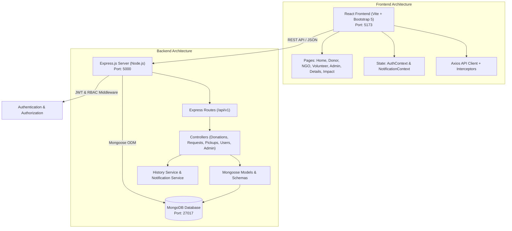
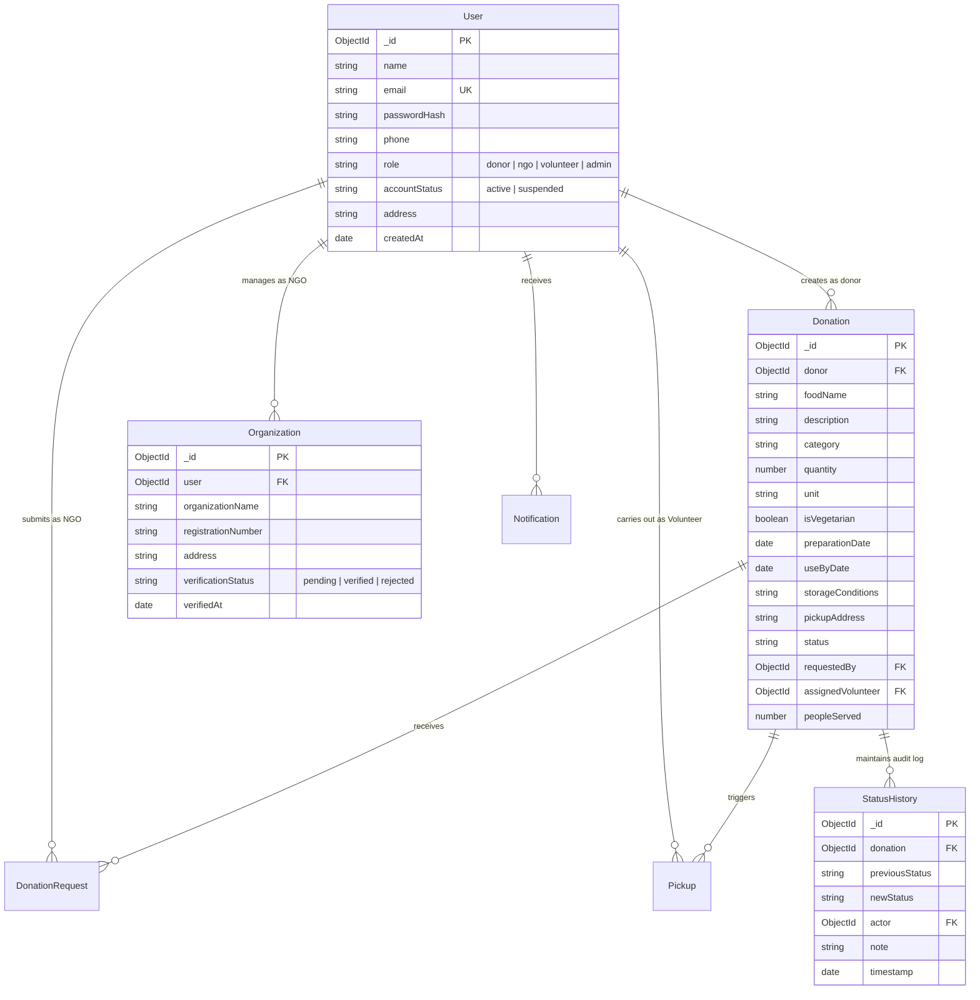
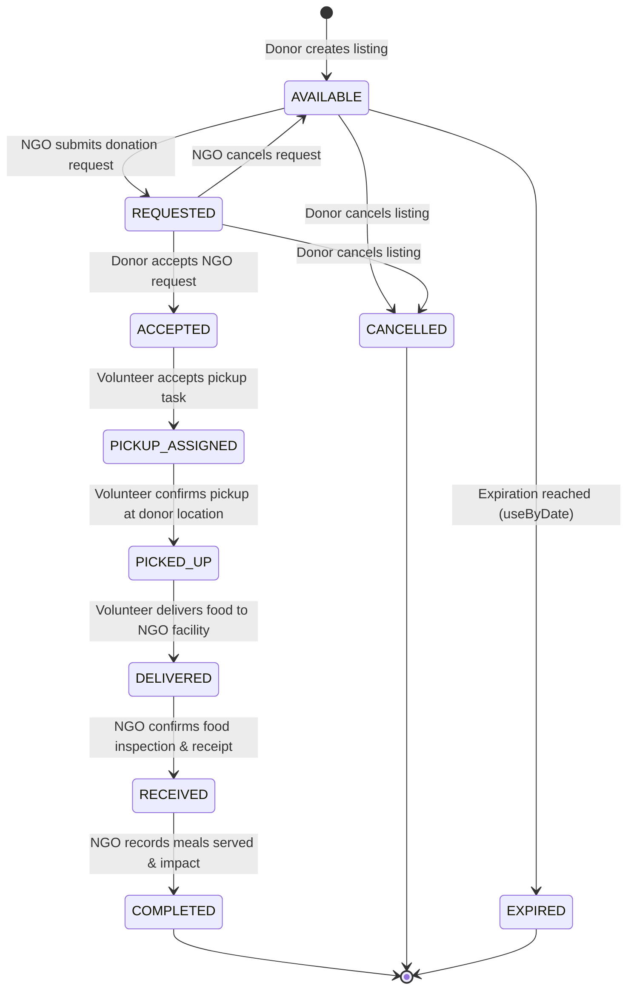

# FoodRescue — System Architecture & Design Specification

## 1. High-Level System Architecture

---

## 2. Database Entity Relationship (ER) Schema

---

## 3. Donation Lifecycle State Machine

---

## 4. Role-Based Access Control (RBAC) Matrix

| Endpoint | Method | Public | Donor | NGO | Volunteer | Admin |
| :--- | :---: | :---: | :---: | :---: | :---: | :---: |
| `/api/v1/auth/login` | POST | Yes | Yes | Yes | Yes | Yes |
| `/api/v1/auth/register` | POST | Yes | Yes | Yes | Yes | No (Seed) |
| `/api/v1/donations` | GET | Yes | Yes | Yes | Yes | Yes |
| `/api/v1/donations` | POST | No | **Yes** | No | No | Yes |
| `/api/v1/donations/:id` | PATCH | No | **Owner** | No | No | Yes |
| `/api/v1/donations/:id/cancel` | POST | No | **Owner** | No | No | Yes |
| `/api/v1/donations/:id/request` | POST | No | No | **Yes** | No | Yes |
| `/api/v1/requests/:id/accept` | POST | No | **Owner** | No | No | Yes |
| `/api/v1/pickups` | POST | No | No | No | **Yes** | Yes |
| `/api/v1/pickups/:id/status` | PATCH | No | No | No | **Assigned** | Yes |
| `/api/v1/donations/:id/receive`| POST | No | No | **Requester** | No | Yes |
| `/api/v1/donations/:id/distribute`| POST | No | No | **Requester** | No | Yes |
| `/api/v1/admin/*` | ALL | No | No | No | No | **Yes** |
| `/api/v1/users` | GET | No | No | No | No | **Yes** |
